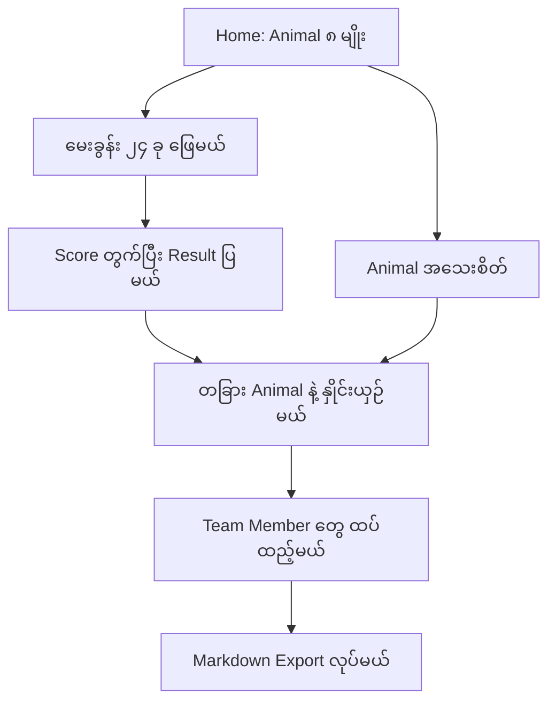

# Office Zoo

**Office Zoo က Harry Hein ရဲ့ project ပါ။** [မူရင်း app](https://office-zoo.vercel.app/) ကို ကြည့်ပြီး လေ့လာနိုင်ပါတယ်။ ဒီ repository ကိုလည်း နောက်လာမယ့်သူတွေ ကိုယ်ပိုင် project ရေးတဲ့အခါ လေ့လာလို့ရအောင်၊ idea ယူလို့ရအောင် ထားပေးထားတာပါ။

[OfficeZoo.json](OfficeZoo.json) ထဲက data တွေနဲ့ ကိုယ်ကြိုက်တဲ့ programming language ကို သုံးပြီး Web၊ Mobile၊ Desktop app ရေးနိုင်ပါတယ်။ ရေးသားပုံနဲ့ workflow ရှင်းပြပုံကို [Burma Project Ideas](https://github.com/burma-project-ideas) ရဲ့ [Myanmar Proverbs](https://github.com/burma-project-ideas/myanmar-proverbs) နဲ့ [Dream Dictionary](https://github.com/burma-project-ideas/dream-dictionary) project တွေလို လေ့လာရလွယ်အောင် ပြင်ဆင်ထားပါတယ်။ ဒီ repository က အဲ့ဒီ organization ရဲ့ project တော့ မဟုတ်ပါဘူး။

## အကျဉ်းချုပ်

လုပ်ငန်းခွင်မှာ ကိုယ်က ဘယ်လိုပုံစံနဲ့ အလုပ်လုပ်တတ်လဲဆိုတာ မေးခွန်း ၂၄ ခု ဖြေပြီး လေ့လာကြည့်နိုင်မယ့် Quiz app ပါ။ မေးခွန်းတစ်ခုမှာ ရွေးချယ်စရာ အဖြေ ၅ ခု ပါမယ်။ ဖြေပြီးရင် ကိုယ့်အဖြေတွေအပေါ် မူတည်ပြီး Animal Type တစ်ခု ထွက်လာမယ်။

Animal Type က Bee၊ Hippo၊ Leopard၊ Peacock၊ Snake၊ Bull၊ Owl၊ Sloth ဆိုပြီး ၈ မျိုး ပါပါတယ်။ Type တစ်ခုချင်းစီရဲ့ အားသာချက်၊ သတိထားရမယ့်အချက်နဲ့ အလုပ်လုပ်ပုံတွေကို ဖတ်နိုင်မယ်။ တခြား Type တွေနဲ့ အတူအလုပ်လုပ်တဲ့အခါ ဘယ်နေရာမှာ အဆင်ပြေနိုင်လဲ၊ ဘာတွေ ညှိယူသင့်လဲဆိုတာလည်း နှိုင်းယှဉ်ကြည့်နိုင်မယ်။

အရင်ဆုံး Animal List နဲ့ Detail Page ရေးကြည့်ပါ။ အဲ့ဒီနှစ်ခု ရပြီဆိုမှ Quiz နဲ့ Compare ကို ဆက်ရေးလို့ရပါတယ်။

## App ရဲ့ Workflow

### ၁။ Home Page

ပထမဆုံး Page မှာ Animal ၈ မျိုးကို ပြပေးပါမယ်။ `OfficeZoo.json` ထဲက `animalOrder` အစီအစဉ်အတိုင်း `animals` ထဲမှာ ID နဲ့ ရှာပြီး ထုတ်ပြနိုင်ပါတယ်။

ဥပမာ `animalOrder` ထဲက `bee` ကို ယူပြီး `animals["bee"]` ကို ဖတ်ရင် Bee ရဲ့ နာမည်၊ မိတ်ဆက်စာနဲ့ Trait တွေကို ရပါမယ်။ မြန်မာ/အင်္ဂလိပ် ဘာသာစကား ရွေးဖို့နဲ့ Quiz စဖို့ Button တွေလည်း ထားပေးနိုင်ပါတယ်။

### ၂။ Animal Detail Page

Animal တစ်ခုကို နှိပ်လိုက်ရင် အဲ့ဒီ Animal ရဲ့ အသေးစိတ်ကို ပြပေးပါမယ်။ ဥပမာ Bee ကို နှိပ်ရင် `animals["bee"]` ထဲက အချက်အလက်တွေကို သုံးရမှာပါ။

| ပြချင်တဲ့အချက် | English Field | မြန်မာ Field |
| --- | --- | --- |
| နာမည် | `name` | `mm` |
| မိတ်ဆက်စာ | `blurb` | `blurbMm` |
| အားသာချက်တွေ | `strengths` | `strengthsMm` |
| သတိထားရမယ့်အချက်တွေ | `watchouts` | `watchoutsMm` |

`traits` ထဲမှာ People Focus၊ Pace၊ Assertiveness၊ Analysis၊ Visibility၊ Adaptability ဆိုတဲ့ အချက် ၆ ခုရဲ့ တန်ဖိုးတွေ ပါပါတယ်။ Bar Chart သို့မဟုတ် Radar Chart နဲ့ ပြနိုင်ပါတယ်။ အလုပ်လုပ်ပုံဆိုင်ရာ အကြံပြုချက်တွေကိုတော့ `animalGuidance[animalId]` ကနေ ထပ်ယူနိုင်ပါတယ်။

### ၃။ Quiz Page

မေးခွန်းတွေကို `questions` ထဲကနေ တစ်ခုချင်းစီ ထုတ်ပြပါမယ်။ မေးခွန်း ၂၄ ခု ပါပြီး တစ်ခုစီမှာ `options` ၅ ခု ရှိပါတယ်။

- အင်္ဂလိပ်လို မေးခွန်းပြမယ်ဆိုရင် `prompt.en` ကို သုံးပါ။
- ကိုယ့်အတွက် မြန်မာလို ဖြေမယ်ဆိုရင် `prompt.my.self` ကို သုံးပါ။
- တခြားသူတစ်ယောက်အကြောင်း မြန်မာလို ဖြေမယ်ဆိုရင် `prompt.my.other` ကို သုံးပါ။
- အဖြေစာသားကို `options` ထဲက `text.en` သို့မဟုတ် `text.my` ကနေ ယူပါ။

User ရွေးထားတဲ့ Option ကို သိမ်းထားပါ။ Option ထဲက `animalId` ကို Result တွက်တဲ့အခါ သုံးရပါမယ်။ မေးခွန်းစာသားနဲ့ အဖြေစာသားတွေကို Code ထဲမှာ ထပ်ရေးဖို့ မလိုပါဘူး။

### ၄။ Result Page

မေးခွန်းတွေ ဖြေပြီးရင် ရွေးထားတဲ့ အဖြေတွေနဲ့ Score တွက်ပါမယ်။ Score အမြင့်ဆုံး Animal ကို ရှာပြီး `animals[resultAnimalId]` ထဲက Profile ကို ပြပေးရမှာပါ။

မူရင်း app နဲ့ Result တူချင်ရင် အောက်က **Result တွက်ပုံ** အတိုင်း ရေးပါ။ ရွေးထားတဲ့ `animalId` အရေအတွက်ကိုပဲ ရေတွက်တာနဲ့ မူရင်း Result ကို မရနိုင်ပါဘူး။

### ၅။ Compare Page

ကိုယ့် Animal Type နဲ့ နှိုင်းယှဉ်ချင်တဲ့ Animal Type ကို ရွေးပါမယ်။ ဥပမာ Bee နဲ့ Owl ဆိုရင် `compatibilityScores["bee-owl"]` ကို ဖတ်ပြီး Percentage ပြနိုင်ပါတယ်။

`bee-owl` မရှိရင် `owl-bee` နဲ့ ပြန်ရှာပါ။ နှစ်ခုလုံး မရှိမှ မူရင်း app က Default Score `50` ကို သုံးပါတယ်။ Verdict ကိုတော့ `compatibilityVerdicts` ထဲမှာ အပေါ်ကနေ စစ်ပြီး Score က `minScore` ထက် ကြီးတာ သို့မဟုတ် တူတာကို ပထမဆုံးတွေ့တဲ့အခါ ယူပါ။

အတူအလုပ်လုပ်ပုံနဲ့ အကြံပြုချက်တွေကို `relationships["bee"]["owl"]` ကနေ ရှာနိုင်ပါတယ်။ ဒီစာသားတွေက ဘယ်သူ့ဘက်ကနေ ဖတ်လဲဆိုတာအပေါ် မူတည်ပါတယ်။ `relationships["owl"]["bee"]` နဲ့ အတူတူလို့ မယူပါနဲ့။ Entry မရှိရင် Score နဲ့ Animal Profile ကိုပဲ ပြပေးပါ။

| အကြောင်းအရာ | English Field | မြန်မာ Field |
| --- | --- | --- |
| အတူအလုပ်လုပ်ပုံ | `dynamic` | `dynamicMm` |
| အချင်းချင်း ဖြည့်ဆည်းပေးနိုင်တာ | `complement` | `complementMm` |
| အဆင်မပြေဖြစ်နိုင်တာ | `clash` | `clashMm` |
| လုပ်သင့်တာတွေ | `dos` | `dosMm` |
| ရှောင်သင့်တာတွေ | `donts` | `dontsMm` |

### ၆။ Team Comparison နဲ့ Save / Share

Pair Comparison ရပြီဆိုရင် Team Member တွေ ထပ်ထည့်ပြီး ကိုယ့် Type နဲ့ တစ်ယောက်ချင်းစီ နှိုင်းယှဉ်ပေးနိုင်ပါတယ်။ နာမည်၊ ရာထူး ဖြည့်ချင်ရင် ဖြည့်နိုင်အောင် ထားပြီး Result ကို Markdown ဖိုင်အဖြစ် Export လုပ်ပေးနိုင်ပါတယ်။ ဒီအပိုင်းမှာလည်း အပေါ်က JSON Data တွေကိုပဲ ပြန်သုံးရမှာပါ။

Result နဲ့ Language/Theme ရွေးထားတာကို Browser ရဲ့ Local Storage မှာ သိမ်းနိုင်ပါတယ်။ Animal Profile ကို Share ချင်ရင် `?sign=bee` လို Query Parameter နဲ့ ID ကို ပို့ပေးနိုင်ပါတယ်။



အပေါ်က Flow က ကိုယ်ပိုင် app ရေးဖို့ လမ်းညွှန်ပါ။ လက်ရှိ Reference App မှာ နာမည်/ရာထူး ဖြည့်နိုင်တဲ့ Participant Step နဲ့ ၃ စက္ကန့်ကြာ Calculating Screen လည်း ပါပါတယ်။ အသေးစိတ်ကို [WORKFLOW.md](WORKFLOW.md) မှာ ဆက်ဖတ်နိုင်ပါတယ်။

## JSON ထဲမှာ ဘာတွေ ပါလဲ

Data အားလုံးကို [OfficeZoo.json](OfficeZoo.json) ကနေ ယူသုံးနိုင်ပါတယ်။ မြန်မာစာ မပျက်ဖို့ ဖိုင်ကို `UTF-8` နဲ့ ဖတ်ပါ။

| Field | အသုံးပြုပုံ |
| --- | --- |
| `project` | Project နာမည်၊ Harry Hein ရဲ့ Credit၊ Website နဲ့ ဘာသာစကားများ |
| `animalOrder` | Animal ပြမယ့်အစီအစဉ်နဲ့ Quiz Score တူရင် ဦးစားပေးမယ့်အစီအစဉ် |
| `animals` | Animal ID နဲ့ ရှာနိုင်တဲ့ Profile၊ အားသာချက်နဲ့ Trait တန်ဖိုးများ |
| `traits` | Trait ၆ ခုရဲ့ Key နဲ့ Label များ |
| `questions` | မေးခွန်း ၂၄ ခု၊ ဘာသာစကားအလိုက် စာသားနဲ့ ရွေးချယ်စရာအဖြေများ |
| `compatibilityScores` | Animal အချင်းချင်းနှိုင်းယှဉ်တဲ့ Score ၃၆ ခု၊ Type တူတဲ့ Pair တွေလည်း ပါပါတယ် |
| `compatibilityVerdicts` | Score အလိုက် ပြမယ့် Verdict နဲ့ `minScore` သတ်မှတ်ချက်များ |
| `relationships` | Animal နှစ်မျိုးရဲ့ အတူအလုပ်လုပ်ပုံနဲ့ အကြံပြုချက်များ |
| `animalGuidance` | ဖိအားအောက်က တုံ့ပြန်ပုံ၊ Motivation နဲ့ သင့်တော်တဲ့ အလုပ်ပတ်ဝန်းကျင် |
| `animalKeywords` | Animal တစ်မျိုးချင်းစီရဲ့ အဓိက Keyword များ |
| `archetypeLabels` | Animal Type ကို ဖော်ပြတဲ့ နာမ်နဲ့ နာမဝိသေသနများ |
| `traitDescriptions` | Trait တန်ဖိုး အမြင့်/အနိမ့်အလိုက် ရှင်းပြချက်များ |
| `uiText` | Button နဲ့ UI Label စာသားများ |
| `explanationSteps` | Quiz အလုပ်လုပ်ပုံ ရှင်းပြတဲ့ စာသားများ |
| `calculationText` | Result တွက်နေချိန် ပြမယ့် စာသားများ |

### Option တစ်ခုရဲ့ ပုံစံ

ပထမမေးခွန်းထဲက Option တစ်ခုက ဒီလိုပါ။ User ရွေးတဲ့အခါ ဒီ Option ရဲ့ `animalId` က `hippo` ဆိုတာကို Score တွက်ဖို့ ယူသုံးရမှာပါ။

```json
{
  "animalId": "hippo",
  "text": {
    "en": "Align with the CEO; their read matters more than the slides",
    "my": "CEO ပြောတာကိုပဲ ထောက်ခံလိုက်တယ်၊ slide တွေထက် သူ့အမြင်က ပိုအရေးကြီးတယ်လေ။"
  }
}
```

Question မှာ မြန်မာစာ Key က `my` ဖြစ်ပေမယ့် Animal Profile မှာ `mm`၊ `blurbMm` လို Key တွေ သုံးထားပါတယ်။ Supporting Data တချို့မှာလည်း `en` / `mm` ဖြစ်နိုင်လို့ ကိုယ်သုံးမယ့် Entry ကို အရင်ကြည့်ပါ။ Key အားလုံး တစ်ပုံစံတည်းလို့ မယူပါနဲ့။

Animal ပုံတွေကို `site/cards/`၊ Avatar တွေကို `site/cards/avatars/` ထဲမှာ Animal ID အလိုက် ရှာနိုင်ပါတယ်။ Color က `var(--a-bee)` လို CSS Variable ဖြစ်ပြီး Definition တွေက `site/assets/` ထဲမှာ ရှိပါတယ်။ Mobile/Desktop app မှာ သုံးမယ်ဆိုရင် ကိုယ့် UI အတွက် Color Value ပြန်သတ်မှတ်ပါ။

## Python နဲ့ JSON ဖတ်ကြည့်မယ်

Repository Folder ထဲမှာ ဒီ Code ကို Run ကြည့်ပါ။ Bee ရဲ့ မြန်မာနာမည်၊ ပထမမေးခွန်းနဲ့ Bee–Owl Score ကို ထုတ်ပြပေးပါမယ်။

```python
import json
from pathlib import Path

zoo = json.loads(Path("OfficeZoo.json").read_text(encoding="utf-8"))
print(zoo["animals"]["bee"]["mm"])
print(zoo["questions"][0]["prompt"]["my"]["self"])
print(zoo["compatibilityScores"]["bee-owl"])
```

## JavaScript နဲ့ JSON ဖတ်ကြည့်မယ်

အရင်ဆုံး Repository Folder ထဲမှာ Terminal ဖွင့်ပြီး Server တင်ပါ။ ဒီ Command က Repository Root ကို Serve လုပ်တာဖြစ်လို့ `OfficeZoo.json` ကို ဖတ်လို့ရပါမယ်။

```powershell
python -m http.server 8081 --bind 127.0.0.1
```

[http://127.0.0.1:8081](http://127.0.0.1:8081) ကို ဖွင့်ပြီး Browser Console မှာ အောက်က Code ကို Run ကြည့်နိုင်ပါတယ်။ အဲ့ဒီ Origin မှာ Serve လုပ်ထားတဲ့ ကိုယ့် HTML Page ထဲမှာလည်း သုံးနိုင်ပါတယ်။

```javascript
const response = await fetch('/OfficeZoo.json');
if (!response.ok) throw new Error(`Cannot load dataset: ${response.status}`);
const zoo = await response.json();

const animals = zoo.animalOrder.map(id => zoo.animals[id]);
console.log(animals.map(animal => animal.mm));
console.log(zoo.questions[0].prompt.my.self);

const you = 'bee';
const them = 'owl';
const score = zoo.compatibilityScores[`${you}-${them}`]
  ?? zoo.compatibilityScores[`${them}-${you}`]
  ?? 50;
const verdict = zoo.compatibilityVerdicts.find(item => score >= item.minScore);
console.log(score, verdict.my);
console.log(zoo.relationships[you]?.[them]?.dynamicMm);
```

ဒီ Repository က Private ဖြစ်လို့ Login မလိုတဲ့ Raw GitHub URL နဲ့ Data ကို တိုက်ရိုက် Fetch လုပ်လို့ မရပါဘူး။ JSON ဖိုင်ကို ကိုယ့် Project ထဲမှာ ထည့်သုံးပါ၊ ဒါမှမဟုတ် အပေါ်ကလို Local Server ကနေ ဖတ်ပါ။

## Result တွက်ပုံ

Quiz Result အတွက် Trait ၆ ခုကို သုံးပြီး တွက်ထားပါတယ်။ မူရင်း app နဲ့ တူအောင် ရေးချင်ရင် အဆင့်တွေက ဒီလိုပါ။

1. Animal ၈ မျိုးရဲ့ Trait တစ်ခုချင်းစီအတွက် ပျမ်းမျှတန်ဖိုးကို တွက်ပါ။
2. Animal တစ်မျိုးချင်းစီရဲ့ Trait Vector ကနေ အဲ့ဒီပျမ်းမျှတန်ဖိုးတွေကို နုတ်ပါ။ ရလာတဲ့ Centered Vector ကို သိမ်းထားပြီး နှိုင်းယှဉ်ဖို့ Unit Vector လည်း တွက်ထားပါ။
3. မေးခွန်းအားလုံးရဲ့ **ရွေးချယ်စရာအဖြေ အားလုံး** ထဲမှာ Animal တစ်မျိုးစီ ဘယ်နှကြိမ် ပါလဲ ရေတွက်ပါ။ User ရွေးထားတာတွေကိုပဲ ရေတွက်တာ မဟုတ်ပါဘူး။ Weight က Animal တစ်မျိုးအတွက် ပျမ်းမျှ Option အရေအတွက်ကို အဲ့ဒီ Animal ပါတဲ့ Option အရေအတွက်နဲ့ စားထားတဲ့တန်ဖိုးပါ။
4. User ရွေးထားတဲ့ Option တစ်ခုချင်းစီရဲ့ Animal Centered Vector ကို သက်ဆိုင်ရာ Weight နဲ့ မြှောက်ပြီး ပေါင်းပါ။
5. ရလာတဲ့ Vector နဲ့ Animal တစ်မျိုးချင်းစီရဲ့ Unit Vector ကို Dot Product တွက်ပါ။ Score အမြင့်ဆုံး Animal ကို Result အဖြစ် ယူပါ။ Score တူရင် `animalOrder` မှာ ရှေ့ကျတဲ့ Animal ကို ယူပါ။

အမြင့်ဆုံးနဲ့ အနိမ့်ဆုံး Score ကြား Range က သုညထက်ကြီးပြီး ပထမနဲ့ ဒုတိယ Score ကွာခြားချက်က အဲ့ဒီ Range ရဲ့ ၁၂% ထက် မပိုရင် မူရင်း app က Secondary Animal အဖြစ် ဒုတိယ Animal ကို သတ်မှတ်ပါတယ်။ Compare Percentage ကိုတော့ ဒီ Quiz Score ကနေ ထပ်တွက်တာ မဟုတ်ဘဲ `compatibilityScores` ထဲကနေ ယူတာပါ။

Code နဲ့ ကြည့်ချင်ရင် [data/scoring-original.js](data/scoring-original.js) ကို ဖတ်ပါ။ အဲ့ဒီ Reference Code ထဲမှာ Option ရဲ့ Animal ID ကို `option.a` လို့ သုံးထားပြီး `OfficeZoo.json` မှာတော့ `option.animalId` လို့ ပြောင်းထားပါတယ်။ Reference Code က Main Bundle ထဲက Definition တွေကို သုံးထားလို့ ဖိုင်တစ်ခုတည်း Run လို့ မရပါဘူး။

## Reference App ကို Local မှာ Run မယ်

လက်ရှိ App ကို ဖွင့်ကြည့်ချင်ရင် Python 3 Install လုပ်ထားပြီး Repository Folder ထဲမှာ ဒီ Command ကို Run ပါ။

```powershell
python -m http.server 8080 --bind 127.0.0.1 --directory site
```

[http://127.0.0.1:8080](http://127.0.0.1:8080) ကို ဖွင့်ပါ။ Dependency Install နဲ့ Build လုပ်ဖို့ မလိုပါဘူး။ Server ရပ်ချင်ရင် `Ctrl+C` နှိပ်ပါ။

ဒီ Command က `site/` ကိုပဲ Serve လုပ်တာပါ။ JSON ဖတ်တဲ့ ဥပမာအတွက်တော့ အပေါ်က Port `8081` Command ကို သုံးရပါမယ်။

Reference App က `site/assets/` ထဲက JavaScript Bundle နဲ့ Run ပါတယ်။ `OfficeZoo.json` နဲ့ `data/` ထဲက ဖိုင်တွေကို ပြင်လိုက်တာနဲ့ ဒီ App ပြောင်းသွားမှာ မဟုတ်ပါဘူး။ ကိုယ်ပိုင် App ရေးတဲ့အခါ JSON ကို ဖတ်ပြီး UI နဲ့ Logic ကို ကိုယ်တိုင်ချိတ်ရပါမယ်။ Result နဲ့ Preference တွေကို Browser Local Storage မှာ သိမ်းပြီး Fonts နဲ့ Analytics ကတော့ ပြင်ပ Service တွေကို သုံးပါတယ်။

## JSON Data ပြန်ထုတ်မယ်

သီးခြား Reference Data ဖိုင်တွေက `data/` ထဲမှာ ရှိပါတယ်။ အဲ့ဒီဖိုင်တွေကို ပြင်ပြီး Combined JSON ပြန်ထုတ်ချင်ရင် ဒီ Command ကို Run ပါ။

```powershell
python scripts/export_data.py
```

Animal ID တွေ၊ Question ID ထပ်နေတာရှိမရှိ၊ Option တွေရဲ့ Animal Reference၊ Trait ၆ ခု ပြည့်မပြည့်၊ Compatibility Pair အားလုံး ပါမပါနဲ့ Score Range တွေကို စစ်ပေးပါတယ်။ Relationship Reference နဲ့ JSON ပြန်ဖတ်လို့ရမရကိုလည်း စစ်ပါတယ်။

`OfficeZoo.json` ကိုပဲ တိုက်ရိုက်ပြင်ထားရင် Exporter ပြန် Run တဲ့အခါ အဲ့ဒီအပြောင်းအလဲတွေ ပျောက်သွားပါမယ်။ `data/` ထဲက သက်ဆိုင်ရာဖိုင်ကို ပြင်ပြီး Export ပြန်လုပ်ပါ။ Reference Data နဲ့ ထွက်လာတဲ့ `OfficeZoo.json` ကို Commit တစ်ခုတည်းမှာ ထည့်ပေးပါ။

## Credit

Project နဲ့ Content အတွက် **Harry Hein** ကို Credit ပေးပါတယ် — [Office Zoo](https://office-zoo.vercel.app/)။

Project ကို လေ့လာရလွယ်အောင် ရှင်းပြတဲ့ပုံစံအတွက် **Burma Project Ideas** ကို အခြေခံထားပါတယ်။ ဒီ Credit ဖော်ပြချက်က Content ကို ပြန်လည်ဖြန့်ဝေဖို့ License ပေးထားတာ မဟုတ်ပါဘူး။
