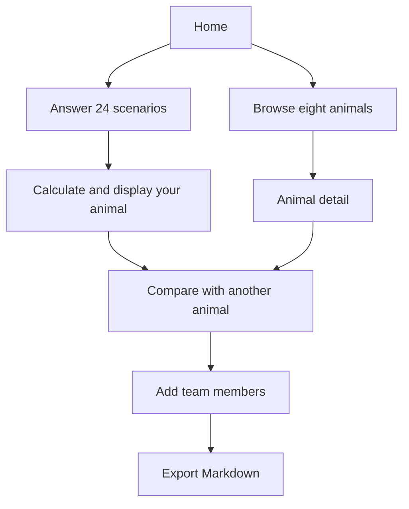

# Office Zoo

**Office Zoo is a project by Harry Hein**, shared here as a reference for learning and inspiration. Try the [live app](https://office-zoo.vercel.app/).

Build a workplace personality quiz with eight animal archetypes, English/Myanmar content, and team comparisons. Use [OfficeZoo.json](OfficeZoo.json) as the dataset for your own web, mobile, or desktop implementation in any language.

## Summary

ဒီ project ရဲ့ ရည်ရွယ်ချက်က JSON data ကို အသုံးပြုပြီး မိမိနှစ်သက်ရာ programming language နဲ့ workplace personality quiz app တစ်ခု တည်ဆောက်လေ့လာနိုင်ဖို့ ဖြစ်ပါတယ်။ မေးခွန်း ၂၄ ခုကို ဖြေဆိုပြီး မိမိရဲ့ animal type ကို သိနိုင်မယ်။ တခြား animal type တွေနဲ့လည်း နှိုင်းယှဉ်နိုင်မယ်။

Users answer 24 workplace scenarios, each with five options, to discover a working style represented by Bee, Hippo, Leopard, Peacock, Snake, Bull, Owl, or Sloth. Each animal has strengths, watchouts, and six trait scores. Users can also browse animals without taking the quiz and compare how different types work together.

This learning-project format is inspired by [Burma Project Ideas](https://github.com/burma-project-ideas), particularly its [Myanmar Proverbs](https://github.com/burma-project-ideas/myanmar-proverbs) and [Dream Dictionary](https://github.com/burma-project-ideas/dream-dictionary) examples. This repository is independent of that organization.

## Build workflow

1. **Home page:** show the eight animals from `animals`, ordered by `animalOrder`. Provide actions to browse profiles or start an assessment. Let users select English or Myanmar.
2. **Animal detail page:** look up `animals[animalId]` and display its description, strengths, watchouts, and six traits. Add practical guidance from `animalGuidance[animalId]`.
3. **Quiz page:** show the 24 entries in `questions`. Display `prompt.en` for English; use `prompt.my.self` for a Myanmar self assessment or `prompt.my.other` for an assessment of another person. Each answer has localized `text` and an `animalId` used for scoring.
4. **Result page:** calculate scores from the selected answers, choose the highest-scoring animal, and display its profile. See the scoring section below to reproduce the reference result.
5. **Compare page:** select your type and another type, read their percentage from `compatibilityScores`, and show the verdict. Read `relationships[yourAnimalId][otherAnimalId]` for relationship guidance when available.
6. **Team page:** repeat comparisons for additional people, allow optional names and job titles, and offer a Markdown export. This is an extension of the pair comparison, using the same dataset.
7. **Save and share:** keep results and language/theme preferences locally. A URL such as `?sign=bee` can identify a shareable animal profile.



These are implementation instructions for learners. The existing reference app also has an optional participant-details step and a three-second calculating screen; [WORKFLOW.md](WORKFLOW.md) describes that behavior.

## JSON data

All project content is available in [OfficeZoo.json](OfficeZoo.json). Text is preserved in UTF-8, including Myanmar. Question fields use descriptive names; animal profiles and supporting text retain their existing field shapes.

| Field | Content / lookup |
| --- | --- |
| `project` | Project name, Harry Hein credit, website, purpose, and languages |
| `animalOrder` | Eight animal IDs in display order and quiz tie-breaking order |
| `traits` | Six trait definitions: people, pace, assertiveness, analysis, visibility, adaptability |
| `animals` | Profiles keyed by animal ID; names, descriptions, strengths, watchouts, and trait values |
| `questions` | 24 scenarios with IDs, localized prompts, and five options each |
| `compatibilityScores` | 36 symmetric pair scores, including same-animal comparisons |
| `compatibilityVerdicts` | Descending minimum score thresholds and localized verdict labels |
| `relationships` | Guidance keyed first by your animal, then the other animal |
| `animalGuidance` | Pressure response, motivation, collaboration tips, and ideal environment |
| `animalKeywords` | Supporting keywords for each animal |
| `archetypeLabels` | Archetype nouns and adjectives |
| `traitDescriptions` | Descriptions for high/low trait values |
| `uiText` | Localized interface labels |
| `explanationSteps` | Content explaining how the quiz works |
| `calculationText` | Text for result-calculation screens |

### Question example

This is the shape of one option from the first question:

```json
{
  "animalId": "hippo",
  "text": {
    "en": "Align with the CEO; their read matters more than the slides",
    "my": "CEO ပြောတာကိုပဲ ထောက်ခံလိုက်တယ်၊ slide တွေထက် သူ့အမြင်က ပိုအရေးကြီးတယ်လေ။"
  }
}
```

Animal profiles use `name` / `mm`, `blurb` / `blurbMm`, `strengths` / `strengthsMm`, and `watchouts` / `watchoutsMm` for English/Myanmar. Relationship text uses fields such as `dynamic` / `dynamicMm`, `complement` / `complementMm`, `clash` / `clashMm`, `dos` / `dosMm`, and `donts` / `dontsMm`. Supporting sections may use `en` / `mm`; inspect their entries before rendering them.

Compatibility is symmetric: look up `bee-owl` first, then `owl-bee`. The reference app defaults to 50 if neither key exists. Relationship narratives are directional, so use the exact `relationships[you][them]` lookup. If a narrative is absent, show the score and animal profiles without inventing guidance.

Animal colors use CSS variables such as `var(--a-bee)` defined in `site/assets/`. Define your own colors when consuming the JSON in another app. Cards are in `site/cards/` and avatars in `site/cards/avatars/`, named by animal ID.

### Read the JSON with Python

Run this from the repository root:

```python
import json
from pathlib import Path

zoo = json.loads(Path("OfficeZoo.json").read_text(encoding="utf-8"))
print(zoo["animals"]["bee"]["name"])
print(zoo["questions"][0]["prompt"]["en"])
print(zoo["compatibilityScores"]["bee-owl"])
```

### Read the JSON in a browser

Serve the repository root to expose the dataset:

```powershell
python -m http.server 8081 --bind 127.0.0.1
```

From a page served on that origin:

```javascript
const response = await fetch('/OfficeZoo.json');
if (!response.ok) throw new Error(`Cannot load dataset: ${response.status}`);
const zoo = await response.json();
const animals = zoo.animalOrder.map(id => zoo.animals[id]);
console.log(animals, zoo.questions[0].options);
```

The GitHub repository is private, so anonymous raw GitHub requests cannot read its data. Include the JSON in your own project or serve it locally.

## Quiz scoring

To match the reference app, use the six-trait scoring process rather than simply counting selected animal IDs:

1. Calculate the mean value of each trait across all eight animals.
2. Subtract those means from each animal's trait vector and normalize each centered vector to unit length for comparison.
3. Count how often each animal appears across **all available answer options**, not only the user's answers. An answer's weight is the average option count per animal divided by the count for its animal.
4. Sum the selected animals' centered vectors multiplied by those weights.
5. Take the dot product of that sum with each normalized animal vector. The highest score wins; ties follow `animalOrder`.

The reference app identifies a secondary animal when the top-two gap is at most 12% of the full score range. Compatibility is separate: use the fixed pair table and the first matching threshold in `compatibilityVerdicts`.

See [data/scoring-original.js](data/scoring-original.js) for the reference implementation. It uses the original question shape (`option.a`); the reusable dataset calls that field `option.animalId`. The reference script depends on other bundle definitions and is not standalone.

## Run the reference app

With Python 3 installed, run:

```powershell
python -m http.server 8080 --bind 127.0.0.1 --directory site
```

Open [http://127.0.0.1:8080](http://127.0.0.1:8080). No install or build step is required. Press `Ctrl+C` to stop the server.

The reference app stores results and preferences in browser local storage. Fonts and analytics use external services. It runs from the bundle in `site/assets/`; editing `OfficeZoo.json` or `data/` does not change that app. Use the JSON as input to your own implementation.

## Maintain the dataset

The individual reference files are in `data/`. After changing them, regenerate and validate the combined dataset:

```powershell
python scripts/export_data.py
```

The exporter checks animal IDs, unique question IDs, option references, six-trait coverage, all compatibility pairs, score ranges, relationship references, and JSON round-trip integrity. Keep both the reference files and generated `OfficeZoo.json` in the same commit.

## Credits

Project and content: **Harry Hein** — [Office Zoo](https://office-zoo.vercel.app/).

Learning-project presentation inspired by **Burma Project Ideas**. Attribution does not establish a license to redistribute the content; no new license is granted here.
